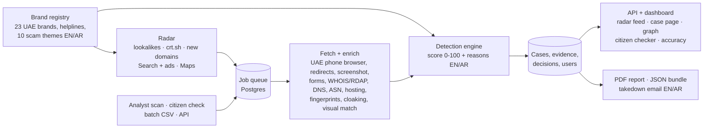

# ScamShield

**Finds UAE scam websites before they find victims.** Team CipherGuard · 42 Abu Dhabi × Abu Dhabi Police hackathon, November 2026.

ScamShield watches for new websites, certificates, search results and Maps listings that imitate UAE government services, banks and delivery companies. It opens each one the way a UAE resident's phone would, scores it FRAUD / SUSPICIOUS / LEGIT with reasons in Arabic and English, and packages police-ready evidence for a takedown.

> Team plan, task lists and timeline: [docs/PLAN.md](docs/PLAN.md).

## The problem

Residents receive SMS and WhatsApp links, search ads and Maps listings for "TAMM traffic fines with 90% discount", "UAE PASS verification", "Emirates Post parcel fee" or a "bank customer care" number. The pages copy the real brand, ask for card details, OTP codes or Emirates ID, and often stay online for days. Police and brand owners usually learn about them from victims, after the money is gone.

## What ScamShield does

| | |
| --- | --- |
| **Finds them first** (no one pastes anything) | Five radars: lookalike domains of 23 UAE brands that exist in DNS (typos, homoglyphs, brand + bait word), new TLS certificates naming a brand (Certificate Transparency, crt.sh), newly registered domains (daily list), Google Search results and ads, and Google Maps listings with an unofficial website or a fake helpline number |
| **Looks like a victim** | A headless browser with a UAE phone profile (Arabic, Asia/Dubai) follows short links and redirects, takes a screenshot (SHA-256), reads the text and the form fields (password, card, OTP, Emirates ID), and spots remote-access app and APK pushes. A second visit as a foreign desktop browser detects **cloaking** |
| **Knows who is behind it** | WHOIS/RDAP (including `.ae`), DNS, IP → ASN, hosting provider and abuse contacts; shared platforms (Vercel, Netlify, …) are recognised so their old WHOIS never makes a scam look trustworthy |
| **Decides and explains** | A detection engine scores 0–100 with reasons in **English and Arabic**: official-domain allowlist, popular sites, phishing feeds, a URL model, brand lookalikes and typosquats, URL shape, Arabic/English scam wording (10 UAE scam types), page signals, domain age, visual match against the real brand sites, cloaking and the Maps helpline check |
| **Connects the dots** | A scam-network graph links domains that share an IP, registration day, final host, favicon, page template, tracker ID or WhatsApp/phone contact |
| **Hands police the evidence** | One-click **PDF evidence report** (A4, English + Arabic: verdict, reasons, screenshot + hash, redirect chain, WHOIS, hosting, related domains, analyst decisions), a JSON evidence bundle, and a takedown email in English and Arabic addressed to the registrar and the host |
| **Fits the workflow** | Analyst and admin roles (JWT login); every confirm/dismiss is logged with who, when and why. A public citizen checker answers "is this link or phone number safe?" in plain Arabic or English. **Batch mode** scores a file of URLs into a CSV |

## Results

### Held-out test set (URL only)

**11,134 URLs** whose sites never appear in training: 3,000 phishing (PhishTank, OpenPhish, Phishing.Database, PhiUSIIL) and 8,134 legitimate (deep pages of 4,000 popular sites + 230 UAE official pages). URL only, no page fetch.

| Counted as positive | Feeds | Precision | Recall | False-positive rate | F1 | UAE official pages flagged |
| --- | --- | --- | --- | --- | --- | --- |
| FRAUD or SUSPICIOUS (score ≥ 30) | off | **0.942** | **0.778** | 1.8% | 0.852 | **0 of 230** |
| FRAUD or SUSPICIOUS (score ≥ 30) | on | 0.944 | 0.826 | 1.8% | 0.881 | 0 of 230 |
| FRAUD only (score ≥ 70) | off | 0.995 | 0.514 | 0.09% | 0.678 | 0 of 230 |

"Feeds off" is the honest number: the test set's phishing URLs come from the same feeds, so with lookups on, part of the recall is lookup, not detection. FRAUD is the near-certain tier (7 false positives in 8,134 legitimate URLs); SUSPICIOUS widens the net for analysts. The thresholds come from a sweep on this set: 25 would gain 1.9 points of recall for a 2.1% false-positive rate, 35 would cut false positives by 0.3 points for 1.6 points of recall.

Most misses are phishing homepages with ordinary names (`http://www.jolifm.com`) that a URL alone cannot reveal; the page fetch (screenshot, forms, brand text, domain age) catches those. Reproduce from `backend/`: `python -m scripts.build_dataset`, `python -m scripts.train_url_model`, `python -m scripts.evaluate [--feeds]`.

### One radar run (24 Nov 2026)

The lookalike radar generated **56,958** typo, homoglyph and brand + bait-word names for the 23 brands and found **978 registered** in DNS, in about 4.5 minutes, with nobody pasting anything. Of the 239 we opened with the full page check, **38 were FRAUD, 64 SUSPICIOUS and 137 LEGIT** (many lookalikes are parked, for sale or unrelated businesses). Checking those finds by hand also caught two engine mistakes before the demo:
- **`adpolice.ae` is Abu Dhabi Police's own alias.** It serves the official site from the same IP as `adpolice.gov.ae` and scored FRAUD 75. It is now an official domain, and any site on a UAE government network counts strongly in its favour.
- **Businesses that just share a name**, such as "Tamm Real Estate" or the ad-fraud firm AdPolice, no longer reach FRAUD without an official-status claim or a request for sensitive data.

The real cases from this run, with screenshots, are in [`data/demo/`](data/demo/urls.txt).

### Live checks with the full page fetch (24 Nov 2026)

| URL | Verdict | Why |
| --- | --- | --- |
| `moi-portal.com` | FRAUD 75 | Domain and page both claim to be the Ministry of Interior, which owns `moi.gov.ae` |
| `tamm-service.site` | SUSPICIOUS 60 | TAMM lookalike that only shows a parked-domain page: watched, not yet reported |
| Phishing kits on hacked `.ae` business sites (`sunnysoldesign.ae`, `rallysteelworks.ae`, `baitalarablaundry.ae`) | FRAUD | Reported phishing URL; a years-old domain no longer counts in its favour |
| `bit.ly` short link from a phishing feed | FRAUD 100 | Followed to the destination |
| `tamm.abudhabi`, `rta.ae`, `emiratesnbd.com`, `adpolice.gov.ae` | LEGIT 0 | Official domains |
| `adpolice.ae` (Abu Dhabi Police alias), `uaetamm.com` ("Tamm Real Estate") | LEGIT 0, SUSPICIOUS 55 | Official alias; a business sharing the name, watched but not reported |
| Local demo pages: fake TAMM fine payment, fake Emirates NBD login, a motoring blog | FRAUD 100, FRAUD 100, LEGIT 27 | Card + OTP + Emirates ID form, brand on a lookalike domain; the blog only mentions the brands |

## How it works



1. A **radar** source (or a person, or the batch tool) adds a URL. It gets a URL-only verdict at once and a fetch job in the queue.
2. A **worker** opens it through an SSRF guard (every request and redirect is checked; private addresses are refused), then enriches it with ownership and hosting data.
3. The **engine** turns URL + evidence into a verdict. Every reason carries a weight, an English and an Arabic sentence, and the evidence it points at.
4. Analysts review cases, confirm or dismiss them, and export the report and takedown request.

Workers scale horizontally (`docker compose up --scale worker=3`); user scans always run before radar finds.

## Tech choices, tools, APIs and data

| Area | Choice | Why |
| --- | --- | --- |
| API | Python 3.11, FastAPI, Pydantic, SQLAlchemy | Typed contracts shared by every part; OpenAPI + TypeScript types for the UI |
| Storage + queue | PostgreSQL (SQLite for local runs), a jobs table with `SKIP LOCKED` | One dependency; no Redis needed |
| Page fetching | Playwright (Chromium), phone profile `ar-AE` / Asia/Dubai | Sees what a UAE resident sees, including JavaScript redirects |
| URL model | scikit-learn: character 3–5-grams (hashed) + hand-made URL features → logistic regression (2 MB) | Fast (~1 ms/URL), works for sites that are already offline |
| Lookalikes | dnstwist permutations + DNS checks | Finds registered lookalikes nobody has reported yet |
| Ownership and hosting | RDAP (rdap.org), `.ae` WHOIS (aeDA), Team Cymru IP→ASN, RDAP abuse contacts | Free, no keys; gives takedown addresses |
| Discovery sources | crt.sh (Certificate Transparency), whoisds.com daily new domains, SerpApi (Google Search + Maps, optional key) | Early detection: certificates and registrations appear before victims do |
| Phishing feeds | PhishTank, OpenPhish (refreshed hourly) | Known-bad lookups |
| Fingerprints | Favicon hash (Shodan mmh3), DOM-template hash, screenshot dHash, tracker IDs, WhatsApp/Telegram contacts | Scam-network graph and visual match against official sites |
| Reports | fpdf2 + HarfBuzz text shaping, Noto Sans / Noto Sans Arabic (OFL) | Correct Arabic in a pure-Python PDF, no browser needed in the API |
| Auth | JWT (PyJWT), scrypt password hashes | Admin and analyst roles, audit log |
| Data we built | `data/brands.json` (23 UAE brands: official domains, helplines, EN/AR names), `data/scam_themes.json` (10 UAE scam types, EN/AR wording and search queries), `data/references.json` (10 official-site fingerprints) | UAE relevance: the engine, radar and helpline check all read them |
| Training/test data | PhishTank, OpenPhish, Phishing.Database, PhiUSIIL; Tranco top sites, crawled deep pages; 230 UAE official pages | Test sites never appear in training |

## Build and run

**Docker (recommended)**

```bash
git clone https://github.com/agegnew/ScamShield.git
cd ScamShield
cp .env.example .env
docker compose up --build        # Postgres + API + page worker + radar
```

- API and interactive docs: http://localhost:8000/docs
- Log in as `admin` / `admin123` or `analyst` / `analyst123` (change them with `SCAMSHIELD_ADMIN_PASSWORD` / `SCAMSHIELD_ANALYST_PASSWORD`).
- The API starts with 8 labelled sample cases (`SCAMSHIELD_MODE=mock`). For real data set `SCAMSHIELD_MODE=live` and `SCAMSHIELD_SEED_DEMO=1` in `.env`: the database then starts with the real cases scanned for the demo (`data/demo/`), and the radar adds new ones as it runs.
- Optional: `SERPAPI_KEY` turns on the Search and Maps radars.

**Without Docker:** see [backend/README.md](backend/README.md) (SQLite, `uvicorn` + `python -m app.workers.runner`). Tests: `pytest -q` in `backend/` (157 tests).

**API contract for the dashboard:** [docs/api/README.md](docs/api/README.md), with TypeScript types and sample JSON for every endpoint.
<!-- TODO(Nati): add the frontend/ run steps here once the dashboard is in the repo. -->

### Batch mode (for a list of URLs)

From `backend/`:

```bash
python -m scripts.batch urls.txt -o verdicts.csv                 # URL only: ~11,000 URLs in 25 s
python -m scripts.batch urls.txt -o verdicts.csv --mode whois    # + domain age and hosting (~5 URLs/s)
python -m scripts.batch urls.csv -o verdicts.csv --mode full     # + page fetch with screenshots (slow)
```

Input: a `.txt` file with one URL per line, or a `.csv` with a `url` column. Output: `url, verdict, flagged, score, brand_target, final_url, reason_codes, reasons_en, reasons_ar, error` (UTF-8 with BOM, opens in Excel). `flagged` is 1 for FRAUD or SUSPICIOUS. If the input has a `label` column, precision and recall are printed. The same is available as `POST /api/batch` (`?format=csv`).

### Demo pages

[demo-pages/](demo-pages/README.md) holds a fake TAMM fine-payment page, a fake Emirates NBD login and a harmless blog, served only on the demo laptop (`docker compose --profile demo up` with `SCAMSHIELD_DEMO_HOSTS` set). They are never put online.

## Repository

| Path | What |
| --- | --- |
| `backend/app/engine/` | Detection engine: checks, combination rules, URL model, phishing feeds |
| `backend/app/workers/` | Fetcher, enrichment, fingerprints, cloaking, visual match, SSRF guard, the five radars, job runner |
| `backend/app/routes/`, `auth.py`, `report.py`, `takedown.py`, `graph.py` | HTTP API, login and roles, PDF report, takedown email, scam-network graph |
| `backend/scripts/` | Dataset build, model training, evaluation, batch mode, demo seeding, contract export |
| `backend/tests/` | 157 tests (`pytest -m live` adds real-network checks) |
| `data/` | Brand registry, scam themes, official-site references, held-out test set, demo snapshot |
| `docs/api/` | API contract (OpenAPI, TypeScript types, sample JSON) |
| `demo-pages/` | Local-only demo scam pages |
| `branding/`, `docs/pitch/` | Brand kit, real UAE scam stories for the pitch |

## Honest limitations

- **Search and Maps need a SerpApi key** (free plan: 100 searches a month). Without one those two radars only replay answers saved on an earlier run (marked `replayed`), so they find nothing new; lookalikes, certificates and new domains are free and always on.
- **The URL model alone misses phishing on ordinary-looking domains**; the page fetch catches more, but a site that is already offline can only be judged on its URL, WHOIS and feeds.
- **Cloaking:** we compare a UAE phone visit with a foreign desktop visit, but a kit that blocks all automated browsers or data-centre IPs can still hide from us.
- **crt.sh is often slow or down**; the radar falls back to the last good answer.
- **Short brand names collide with foreign businesses** ("icp", "moi", "rta"): a live site that never mentions the brand is held back from FRAUD, but a cheap `.xyz` name can still reach it on its URL alone (`icp-online.xyz`, a Japanese company, scores 70).
- **No LLM or image-similarity model yet:** visual match compares favicons and page templates against 10 official sites, not the rendered look of every brand.
- **The accuracy numbers are on public phishing feeds**, which are global; UAE-specific scams are a small part of them. The 230 UAE official pages and the live checks above are our UAE evidence.

## Route to a police pilot

1. Run one radar + worker instance inside the police network against the 23 brands, with analysts confirming cases.
2. Send takedown requests from the generated emails; measure time from registration to detection to takedown.
3. Add brand owners' own lookalike lists and the police's reported-scam data as feeds and training data.
4. Scale workers horizontally; add more brands and the Arabic scam wording as new campaigns appear.

## Team CipherGuard

Agegnew (backend, database, detection engine) · Nati (UI/UX and accessibility) · Simon (workers and discovery) · Samri (research, brand data, pitch).
<!-- TODO: full member names as registered for the hackathon. -->
