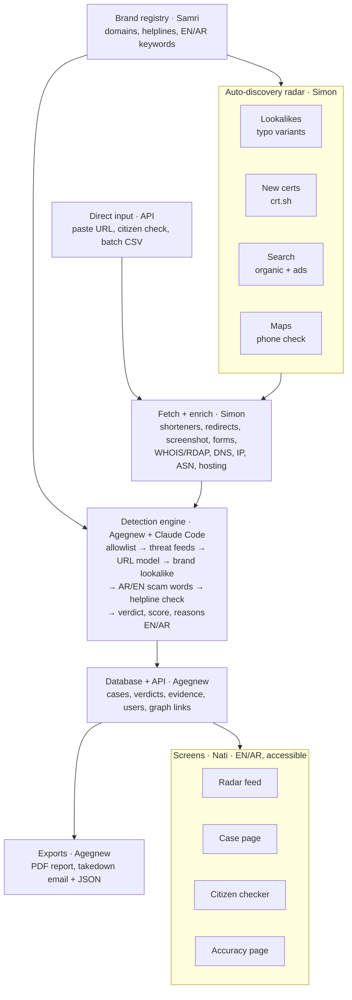

# ScamShield — MVP Plan & Team Assignments

**Updated:** 24 Nov 2026 (kickoff day). **Code freeze:** 00:00. **Submit by:** 06:00 Wed 25 Nov (hard deadline 08:00).

We win with a working engine that finds UAE-brand scams on its own (Search, Maps, new lookalike domains), scores every URL with reasons in Arabic and English, and exports police-ready evidence.

> The design docs in `ScamShield-AI-Documentation/` were written before the kickoff. Where they conflict with this file, this file wins.

## Getting started

```bash
git clone https://github.com/agegnew/ScamShield.git
cd ScamShield
cp .env.example .env
docker compose up --build        # Postgres + API + worker
```

API docs at http://localhost:8000/docs. No Docker? See [`backend/README.md`](backend/README.md) (runs on SQLite).

| Person | Work in | Start with |
| --- | --- | --- |
| Nati | `frontend/` — create the Next.js app there | [`docs/api/README.md`](docs/api/README.md), TypeScript types in [`docs/api/scamshield-api.d.ts`](docs/api/scamshield-api.d.ts), sample JSON in `docs/api/mock/` |
| Agegnew | `backend/app/` (API, DB, engine) | [`backend/app/engine/core.py`](backend/app/engine/core.py) |
| Simon | `backend/app/workers/` | [`fetcher.py`](backend/app/workers/fetcher.py), [`enrich.py`](backend/app/workers/enrich.py), [`radar/`](backend/app/workers/radar/) — each file's docstring says what to build |
| Samri | `data/brands.json`, `data/logos/` | Run `python -m scripts.validate_brands` (from `backend/`) before committing |

Pull before you push, keep commits small, and edit only files your lane owns ([ownership table](backend/README.md#who-owns-what)).

## How we are judged

| Weight | Criterion | What judges check |
| --- | --- | --- |
| 30% | Detection accuracy | Precision and recall on a **hidden test set** of fraud and legit URLs. Few false positives on real banks and government sites. Handles redirects, URL shorteners and cloaking |
| 25% | Early detection and coverage | Newly registered domains, lookalike domains, fresh ads. **Both** Search and Maps, including fake business pages and fake helpline numbers |
| 20% | Explainability and actionability | Risk score with clear reasons. Evidence: screenshots, WHOIS, hosting data, timestamps. Exportable for takedown |
| 15% | UAE relevance and innovation | Arabic/bilingual. UAE banks, TAMM, UAE PASS, traffic fines. Visual similarity, LLM analysis, scam-domain network |
| 10% | Feasibility and presentation | Live demo, scalable design, route to a police pilot, honest about limits |

## MVP scope

At code freeze all seven P0 items run end to end on a laptop, on live data or on clearly labelled fixtures.

**P0 — must ship**

1. **Auto-discovery radar:** lookalike domains of UAE brands, new TLS certificates (crt.sh), Google Search results and ads, Google Maps listings. Nobody pastes anything.
2. **Detection engine:** every URL gets FRAUD / SUSPICIOUS / LEGIT, a 0–100 score and reasons in English and Arabic, even when the site is already offline.
3. **Evidence:** screenshot, redirect chain, WHOIS/RDAP, IP and hosting provider, timestamps. Shown on the case page, exported as PDF plus a takedown request.
4. **Dashboard (EN/AR, full RTL, accessible):** radar feed, cases list, case page, accuracy page.
5. **Citizen checker:** public page. Paste a link or a phone number, get a plain-language verdict in Arabic or English.
6. **Users:** admin and analyst roles; analysts confirm or dismiss a case, logged with who, when and why.
7. **Batch mode + accuracy report:** a list of URLs in, a CSV of verdicts out; our measured precision and recall.

**P1 — only after Gate 3 (21:00), in this order**

1. Scam network graph: domains linked by shared IP, registrar, registration day, favicon or redirect target.
2. Cloaking check: compare a mobile and a desktop fetch.
3. LLM vision check: does the page imitate a brand's look on the wrong domain.
4. Read-aloud verdict on the citizen page, Arabic and English.

**Cut — roadmap slide only:** Chrome extension, phone companion, AR/QR camera, Rescue, SafePay, Redis queues, live push updates.

## How it fits together



The brand registry feeds both the radar and the engine; every screen reads from one API.

## Who owns what

| Person | Role | Owns | First handoff |
| --- | --- | --- | --- |
| Nati | UI/UX and accessibility | Dashboard, citizen checker, EN/AR RTL, design system | UI shell on mock data — 13:00 |
| Agegnew (+ Claude Code) | Backend, DB, users, engine | API, database, roles, detection engine, URL model, accuracy eval, PDF/takedown | API contract + mock JSON — 11:45 |
| Simon | Workers and discovery | Job runner, fetcher, enrichment, radar (lookalikes, crt.sh, Search, Maps) | First real URL fetched + screenshot — 13:00 |
| Samri | Research, creative, pitch | UAE brand registry, scam research, branding, demo pages, deck, video, demo script | brands.json v1 — 12:30 |

Everyone works on mock data until 17:00 so nobody waits on anyone.

## Task lists

### Nati — UI/UX and accessibility

- [ ] **11:45** — Agree screens and API shapes with Agegnew (see Shared contracts)
- [ ] **13:00** — App shell: Next.js + Tailwind + shadcn/ui, EN/AR switch with full RTL, navigation, login page
- [ ] **15:00** — Radar feed: live list of auto-discovered URLs, source badge (Lookalike / New cert / Search / Ad / Maps), verdict chip, brand targeted
- [ ] **17:00** — Case page: verdict + score, reasons in EN/AR, screenshot, redirect timeline, WHOIS + hosting, confirm/dismiss, Export PDF and takedown
- [ ] **19:00** — Citizen checker (public, mobile-first): paste a link or phone number → big plain-language verdict + what to do next
- [ ] **20:00** — Cases list (filter by verdict, source, brand) + accuracy page (precision, recall, confusion matrix)
- [ ] **21:00** — Accessibility pass: WCAG AA contrast, keyboard-only run, visible focus, screen-reader labels, verdict shown by icon + text not colour alone, text-size toggle
- [ ] **P1** — Network graph view; read-aloud verdict (browser speech, Arabic + English)
- [ ] **00:00–02:00** — Polish for the video; operate the laptop during the demo

### Agegnew (+ Claude Code) — backend, DB, users, engine

- [x] **11:45** — Repo + FastAPI skeleton; publish the API contract and mock JSON for Nati
- [x] **13:00** — Database (SQLite through SQLAlchemy, Postgres in Docker): users, brands, candidates, scans, verdicts, cases, decisions, domain links
- [ ] **14:00** — Users: admin and analyst roles, login (JWT), seeded accounts; every confirm/dismiss logged with who, when, why
- [ ] **15:00** — Datasets: phishing URLs from OpenPhish, URLhaus, PhishTank; legit *deep pages* (not only homepages) from top sites and UAE banks/government; 70/30 train/held-out split
- [ ] **17:00** — Engine v1, cheapest layer first: allowlist → threat feeds → URL model → brand impersonation → Arabic/English scam keywords → helpline check → score + reasons EN/AR. Batch CLI + `POST /api/batch`. First precision/recall on the held-out set
- [ ] **19:00** — PDF evidence report + takedown export (JSON + prefilled abuse email to registrar and host)
- [ ] **21:00** — Graph edges (shared IP, registrar, registration day, favicon, redirect target); thresholds tuned on the held-out set toward low false positives
- [ ] **P1** — LLM vision check for borderline cases
- [ ] **00:00** — Freeze; seed demo data; final accuracy numbers to Samri for the deck

### Simon — workers and discovery

Free sources (lookalikes, crt.sh) come first so discovery works even without a SerpApi key.

- [ ] **12:00** — Job runner: worker loop over a jobs table (no Redis); SSRF guard blocks private and internal IPs
- [ ] **13:00** — Fetcher (Playwright): expand shorteners, follow redirects, screenshot, title, page text, form field types (never values), timings
- [ ] **14:30** — Enrichment: RDAP/WHOIS (created date, registrar, abuse email), DNS, IP → ASN + hosting provider
- [ ] **15:30** — Radar 1, lookalikes: typo, homoglyph and brand+keyword variants (e.g. `tamm-fines-pay`) of every domain in brands.json; keep the registered ones
- [ ] **16:30** — Radar 2, new certificates: crt.sh search for brand keywords
- [ ] **18:00** — Radar 3, Search: SerpApi Google, English + Arabic queries ("pay traffic fine", "دفع المخالفات"), organic results and ads
- [ ] **19:30** — Radar 4, Maps: SerpApi Google Maps listings for brand names; compare website and phone with the official domain and helpline
- [ ] **20:30** — Scheduler: radar runs every few minutes, de-duplicates, sends new URLs to the engine
- [ ] **P1** — Cloaking check: mobile vs desktop fetch, flag differences
- [ ] **00:00** — Freeze; save cached radar results as the demo fallback

### Samri — research, creative, pitch

The brand registry is the first thing everyone else needs: the engine, the lookalike radar and the helpline check all read it.

- [ ] **12:30** — `brands.json` v1, about 20 UAE brands: TAMM, UAE PASS, ICP, MOI, RTA fines, Dubai Police, Abu Dhabi Police, Salik, Emirates Post, Aramex, DEWA, e&, du, Emirates NBD, ADCB, FAB, DIB, Mashreq, ADIB, RAKBANK. For each: official domains, official helplines, EN/AR names and keywords, logo file
- [ ] **13:00** — Branding: confirm product and team name, logo, colours, icon → Nati
- [ ] **14:30** — Research: real UAE scam cases (news, police and TDRA warnings) + a list of Arabic and English scam phrases → engine and deck
- [ ] **16:00** — Ask organizers the open questions at the end of this file
- [ ] **16:00** — Two local demo scam pages (fake traffic-fine payment, fake bank login) + one legit control, made with AI tools; Simon serves them locally, never online
- [ ] **20:00** — Deck draft: problem, solution, live demo, architecture, accuracy, UAE focus, police pilot route, honest limitations, team
- [ ] **22:00** — Demo script (3 min) + Q&A cheat sheet
- [ ] **00:00–03:00** — Record and edit the 1-minute demo video
- [ ] **05:00** — Final deck with real accuracy numbers; rehearse the 5-minute version

## Shared contracts (agree by 11:45)

Fixed in the first hour so all four lanes build in parallel. Change one only after telling the whole team.

**Source of truth is code:** [`backend/app/contracts.py`](backend/app/contracts.py) for the shared formats, [`docs/api/README.md`](docs/api/README.md) for the API (with sample JSON for every endpoint).

| Contract | From → to | Fields |
| --- | --- | --- |
| `brands.json` | Samri → everyone | id, name_en, name_ar, category, official_domains[], helplines[], keywords_en[], keywords_ar[], logo |
| Candidate | Simon → DB | url, source (lookalike, ct, search, search_ad, maps, manual, citizen, batch), query, discovered_at, extra {listing_name, phone, address} |
| Evidence | Simon → engine | url, final_url, redirect_chain[{url, status}], http_status, screenshot_path, title, text_excerpt, forms[{action, input_types[], field_hints[]}], rdap {created, registrar, abuse_email}, ip, asn, hosting_org, hosting_abuse_email, fetched_at, fetch_error |
| Verdict | Engine → API/UI | url, verdict, score, brand_target, reasons[{code, weight, text_en, text_ar, evidence_ref}], model_version, scored_at |
| API | Agegnew → Nati | See [`docs/api/README.md`](docs/api/README.md) — 14 endpoints, mock data live now |

## Timeline and gates

| Time (UAE) | Milestone | Done means |
| --- | --- | --- |
| 11:00–11:45 | Sync | Contracts, repo and brand list agreed |
| 13:00 | **Gate 1 — foundations** | API and DB serve mock data; brands.json v1 exists; fetcher screenshots one URL; UI shell runs in English and Arabic |
| 17:00 | **Gate 2 — first slice** | One discovered URL flows radar → fetch → engine → UI; first precision/recall number |
| 21:00 | **Gate 3 — P0 complete** | All seven P0 items work end to end |
| 00:00 | **Code freeze** | Bug fixes only after this |
| 00:00–02:00 | Rehearse | Cold-start demo run; record video footage |
| 02:00–05:00 | Package | README, deck, 1-minute video edit |
| 06:00 | **Submit** on Podium+ | Repo link, deck, video |
| 08:00 | Hard deadline | Late submissions are not pre-screened |

## Kill rules

A missed gate cuts scope; it never moves the freeze.

- **13:00, SerpApi key not working:** Search and Maps run on recorded results, labelled as such; the radar leans on lookalikes and crt.sh, which are free.
- **17:00, no end-to-end slice:** everyone stops new work and fixes the slice; all P1 cancelled.
- **17:00, URL model not beating the rules on the held-out set:** drop the model, keep rules + threat feeds.
- **crt.sh slow or down:** use the results cached from the last good pull.
- **LLM slow or expensive:** switch it off; templated EN/AR reasons stay.
- **21:00, P0 not complete:** no P1 starts.
- **00:00:** freeze, whatever state we are in.

## Demo story (3 minutes)

1. **Problem and solution, under 1 minute:** UAE residents meet fake fine-payment and UAE PASS pages through search and Maps; ScamShield finds them first.
2. **Radar feed:** UAE PASS and TAMM lookalike domains registered this week, found with no human input.
3. **Case page:** FRAUD, its score, reasons in Arabic and English, screenshot, WHOIS, hosting, timestamps.
4. **Maps:** a "bank customer care" listing whose phone is not the official helpline.
5. **Action:** export the PDF and takedown email; show the network graph of sibling domains (if P1 shipped).
6. **Citizen checker:** on a phone, in Arabic, paste a link, get a plain verdict read aloud.
7. **Close:** precision and recall on our held-out set, one honest limitation, the route to a police pilot.

## Open questions

- [ ] Organizers: how is the hidden test set run — do judges call our API or CLI, or hand us a list? Do we need a hosted URL?
- [ ] Organizers: is the pitch slot 5 or 10 minutes? (Kickoff slides 16 and 17 disagree.)
- [ ] Team: do we have a SerpApi key with credits, and an LLM API key?
- [ ] Team: final team name and member names for the submission
