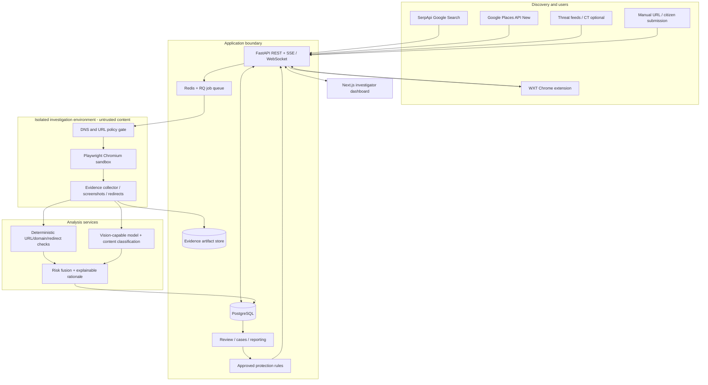
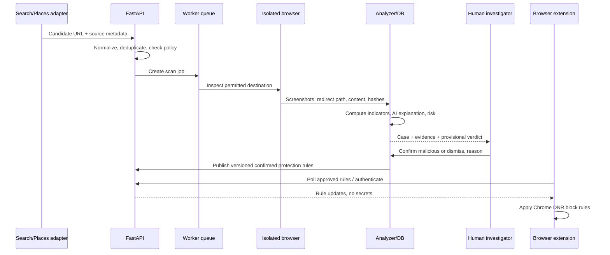
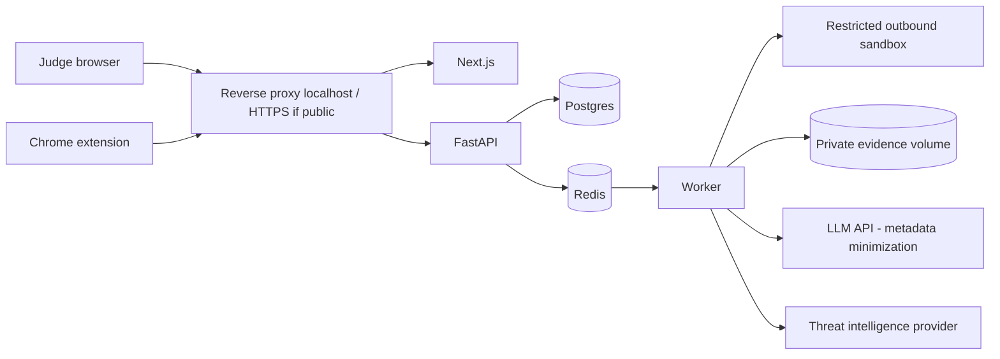

# ARCHITECTURE.md - System and Threat Architecture

**Status:** Proposed architecture; implementation choices require a team ADR.  
**Scope:** A realistic P0/P1 MVP that can extend into a longer-term digital protection platform.

## 1. Architecture goals

- One browser-to-case vertical slice working within 24 hours.
- Loosely coupled discovery adapters so Search, Places, threat feeds and manual reports share one ingestion contract.
- Strong isolation between the main application and untrusted websites.
- Explainable decision-making: the LLM writes analysis, but does not unilaterally blacklist domains.
- Investigator dashboard that reflects authentic job states and evidence.
- Extension that can receive approved protection rules without requiring a page reload.
- Simple local deployment (Docker Compose) instead of Kubernetes/microservices.

## 2. Logical component view



**Critical note:** The logical diagram does not imply that Redis, the investigator API, and an adversarial browser may share unrestricted networking. Their network access must be explicitly segmented.

## 3. User-to-protection sequence



**Never** publish provisional, unverified risk scores as mandatory extension block rules.

## 4. Services and responsibilities

| Component | Responsibility | Explicitly not responsible for |
|---|---|---|
| `web` | Investigator/citizen UI, SSE stream, cases, reports | Crawling or deciding guilt |
| `api` | Auth, API routes, validation, jobs, cases, persistence | Running untrusted page JS |
| `worker` | Queue processing, safe inspection orchestration, retries | Reading raw passwords or handling payments |
| `sandbox` | Constrained browser visit, screenshots, redirect tracing | Open network access to internal infrastructure |
| `analysis` | Feature extraction, model context, explainable provisional scores | Automatic permanent takedown/block of unconfirmed links |
| `extension` | Local rules, UI warnings, on-page sensitive-field checks where permitted | Reading all device apps or capturing user credentials |
| `storage` | Cases, artifacts, hashes, audit trail | Indefinite retention by default |

## 5. Suggested monorepo

```text
scamshield/
  apps/
    web/                       # Next.js dashboard / citizen UI
    extension/                 # WXT + React + MV3
  services/
    api/                       # FastAPI routes + domain models
    worker/                    # queue consumers and analysis orchestration
  packages/
    contracts/                 # generated OpenAPI types / shared schemas
    ui/                        # shared design tokens / reusable components
  infra/
    compose.yaml               # database, Redis, API, web, worker, sandbox
    nginx/ or caddy/           # demo reverse proxy, TLS if public
  fixtures/
    safe/                      # controlled legitimate pages
    suspicious/                # controlled simulation, not actual phishing
    expected/                  # labels and expected case data
  tests/
    integration/
    e2e/
    security/
  docs/                        # this documentation pack
  .env.example
  README.md
```

A simpler repo with `web/`, `api/`, `extension/`, `worker/` is also acceptable. Favor a working deployment over folder purity.

## 6. Boundary and data flow design

1. **Ingestion:** Search and Places providers return candidate records. Do not assume any result is malicious. Store only provider data permitted by its license; Google Place IDs are generally allowed for persistent storage, but Google Maps content is restricted (see integration guide).
2. **Normalization:** Parse HTTP(S); lower-case/punycode hostname where appropriate; remove tracking fragments when safe; retain both original and canonical URL; hash for deduplication.
3. **Admission:** Reject local, loopback, multicast, link-local, cloud metadata, internal DNS names, unsupported ports, and non-HTTP(S) schemes. Revalidate every redirect and DNS resolution.
4. **Investigation:** Independent browser profile, no preexisting sessions/cookies, disabled downloads, no typed credentials, no payment form submission. Capture first and final URL, timestamps, redirect hops, DOM-derived text, screenshot, links and contact hints.
5. **Signals:** Combine known threat-intelligence matches, unusual URL composition, identity claims, mismatched destination, and visual similarity. Avoid treating new domain age alone as proof.
6. **Decision:** Provisional risk score (0-100) + discrete indicators + confidence/limitations. `UNKNOWN` is valid when inspection fails.
7. **Review:** Analyst confirms/dismisses/escalates; case status and rationale recorded in audit log.
8. **Protection:** Publish only reviewed block indicators and version numbers; extension applies browser-managed rules and supports unblocking and expiry.

## 7. Storage & concurrency

- **PostgreSQL:** candidates, scans, observations, findings, cases, approvals, rules, audits; URLs and screenshots are sensitive and require access controls.
- **Redis/RQ:** asynchronous jobs, bounded concurrency, TTL for ephemeral state; **Postgres is the system of record**.
- **Artifacts:** local private volume during hackathon; production could use S3-compatible storage with short-lived signed URLs. Store hash, capture timestamp, collector version, provenance.
- **Events:** Use SSE for server-to-dashboard status updates; use WebSockets only if genuinely bidirectional interaction is needed. Browser extension can poll versioned feed for MVP simplicity.
- **Idempotency:** key on `(canonical_url, profile, analyzer_version, time_bucket)` for bounded rescans; still retain observation timestamps.
- **Limits:** workers 2-4 concurrent visits initially, ~15-25 sec browser timeout, max 5 redirect hops, max 1-3 MB fetched HTML per page (configuration, not security guarantees). Protect upstream quota.

## 8. Deployment topology (hackathon)



- **Local-only demo** is preferred to public deployment if security review is incomplete.
- Never expose database/Redis to the internet. Keep provider keys server-side. Require token-based auth for investigator routes.
- If outbound visit capability is unavailable, use controlled fixtures labeled **SIMULATED**, never pose as live discovery.

## 9. Availability & failure behavior

| Failure | Expected response |
|---|---|
| SerpApi unavailable/quota exhausted | Manual URL + controlled fixtures; UI displays discovery adapter degraded |
| Google Places missing billing/key | Disable Maps discovery; keep adapter interface and demo with labeled fixture |
| LLM timeout | Deterministic indicators remain, AI finding marked unavailable |
| Worker crashes | Scan becomes `failed` or requeued once; no false clean verdict |
| Screenshot capture blocked | Store metadata and reason; mark visual analysis inconclusive |
| Risk decision uncertain | Use `needs_review`, not confirmed malicious |
| Extension cannot fetch rules | Maintain last trusted signed/versioned rules within expiry; display sync error |

## 10. Architecture decision records to finalize

- ADR-001: Search discovery provider and contingency.
- ADR-002: Maps adapter and compliant data storage.
- ADR-003: Scan isolation and egress enforcement.
- ADR-004: Rule publishing approval model.
- ADR-005: P0 scope and one P1 differentiator.
- ADR-006: SSE vs WebSocket for live dashboard.

See [decisions](docs/17-DECISIONS-AND-RISKS.md), [security](docs/11-SECURITY-AND-PRIVACY.md) and [detector](docs/06-DETECTION-ENGINE.md).
