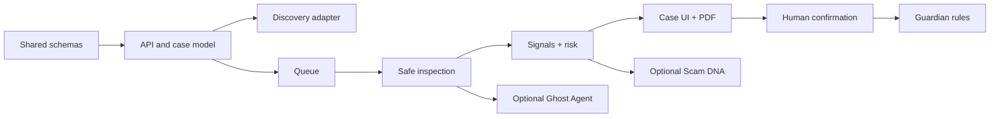

# Delivery strategy: Foundation -> Competitive Edge -> Moonshot -> Platform

## What the schedule really allows

The event spans several calendar dates, but the **coded hackathon window is 24 hours**: Tue **24 Nov 2026 at 08:00** to Wed **25 Nov at 08:00**. Presentations follow on Thu 26 Nov. Plan engineering as a hard 24-hour deadline, not three full coding days.

## Phase 0 - Pre-event preparation (before kick-off)

**Goal:** Remove account and integration uncertainty, document scope, rehearse repository setup. Follow all organizer rules on pre-event work and eligibility: do **not** assume prebuilt code is allowed unless verified.

- Complete individual registrations, team formation and check official deadline notices.
- Confirm team roles; pick one backend/AI lead, one UI/UX lead, one integration/extension lead, one demo/test lead if available.
- Obtain SerpApi, Google Places, Web Risk/urlscan, AI model keys and quota estimates; **never commit keys**.
- Select controlled safe and synthetic suspicious fixtures; record legal provenance.
- Agree on P0 criteria and one hero P1 feature.
- Reserve domain, repo, naming, pitch outline if allowed; follow competition-specific preparation rules.

**Exit gate:** Everyone can explain the same scenario and success criteria.

## Phase 1 - Foundation (P0, hours 0-14 target)

**Must ship:** Functional URL admission and at least one discovery path, isolated analysis, explainable scores, case dashboard, evidence, review and report.

| Time since kickoff | Team focus | Proof / gate |
|---|---|---|
| 00:00-02:00 | Repo, Compose, migrations, shared contracts, fixture server | Health endpoints; CI shell; fixtures load |
| 02:00-05:00 | URL parsing/SSRF gate, queue, scan statuses, storage | One controlled scan ends with DB + screenshot |
| 05:00-08:00 | Search OR Places adapter, URL features, redirect tracing | Candidate -> scan from one real provider or labeled fallback |
| 08:00-11:00 | AI explanation, risk evidence, screenshot references | Safe vs suspicious fixture produce distinct evidence |
| 11:00-14:00 | Dashboard case view, review, PDF report | Independent teammate completes end-to-end workflow |

**Hard freeze at hour 14:** P0 user story must be fully functional. If not, stop adding features and fix P0.

## Phase 2 - Competitive Edge (P1, hours 14-19 target)

**Choose one hero based on progress, with a backup option:**

- **Option A: Guardian + Immunity Network.** Confirm case -> update approved rules -> block domain in Chrome extension. Visible, rigorous end-to-end value. Test rollback.
- **Option B: Ghost Agent + TrustChain.** Controlled multi-hop deceptive journey -> captured screenshots and redirect timeline. Low extension dependency, excellent investigator demo.
- **Option C: Scam DNA.** Related-site cluster with at least two independently observed shared fingerprints. Ensure the graph explains the evidence.

**Decision rule:** If two options are half-finished, choose one. Do **not** promise all three.

**Exit gate:** A second laptop/profile can reproduce the differentiator without developer intervention.

## Phase 3 - Demo hardening (hours 19-24)

- 19:00-21:00: Run safe vs suspicious regression tests, SSRF tests, permissions checks, PDF export, extension sync if included.
- 21:00-22:30: Freeze code and rehearse live demo with cold restart and no privileged test data.
- 22:30-23:30: Prepare submission URLs/files, pitch screenshots, architecture slide, risk/limitations slide.
- 23:30-24:00: Final independent verification, submit **before** 08:00, save evidence of submission.

**Never leave the first complete run until the last hour.**

## Phase 4 - Finalists' presentation (after submission)

- Do not rely on code changes after the submission deadline unless organizer rules explicitly permit them.
- Rehearse a 60-90 second hero demo, a 3-minute narrative and a deeper technical Q&A.
- Prepare local controlled demo if APIs/billing/internet fail.
- Show one real test metric and one honest limitation rather than unsupported grand claims.

## Phase 5 - Product roadmap (beyond competition)

| Horizon | Capabilities | Dependency |
|---|---|---|
| Near term | Consistent Search + Maps coverage, MirrorLens, Scam DNA, structured reports, Arabic/English UX | Safe crawlers, provider/legal review |
| Medium term | Guardian scale, Immunity Network, SafeView, Tripwire, Reality Switch, SafePay, ChatSense | Auth, audit, false-positive process |
| Long term | Phone Connect native companion, ScamShield AR, Privacy Cloak at scale, Rescue, Trusted Circle | Mobile OS permissions, privacy architecture |
| Research | CT/Future Radar, Outbreak Intelligence, Scam Vaccine, calibrated detection models | Historical datasets and validation |

## Workstream dependencies

## Kill / continue gates

1. **Hour 05:** No screenshot + DB observation? Fix worker and network before continuing.
2. **Hour 08:** No reliable discovery? Switch to manual + prepared offline fixtures, mark results as fixture; keep one live adapter stub clear.
3. **Hour 11:** Model too slow/expensive? Disable it and use deterministic feature evidence; add explanation later.
4. **Hour 14:** No end-to-end MVP? Cancel P1/P2.
5. **Hour 19:** P1 unreliable? Hide behind disabled feature flag; focus on demo and reporting.
6. **Hour 22:** No cold-start rehearsal? Stop coding and rehearse.

## Deliverables and ownership checklist

- [ ] Repo, environment and `docker compose up` runbook
- [ ] Actual API + data migrations
- [ ] One working source adapter and manual submission
- [ ] Safe analyzer + raw evidence artifacts
- [ ] Risk findings and case review
- [ ] PDF exporter and demo case
- [ ] Automated tests; visible evaluation notes
- [ ] Hero differentiator only after P0
- [ ] Pitch + fallback scenario + limitations
- [ ] Final submitted artifact and owner acknowledgement
