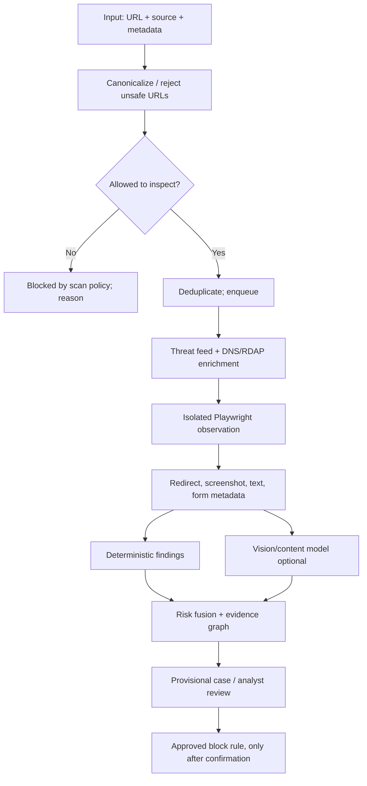

# AI detection engine - algorithms, scoring, evidence and limits

## 1. Detection philosophy

The engine does not answer "is this person a criminal?" It answers **"what evidence indicates this link/site may pose risk, how reliable is that evidence, and what should a human examine next?"** Each result includes uncertainty, and a failed scan is **unknown**, never "clean." LLM output is not a security oracle.

## 2. Pipeline contract



## 3. Ingestion and normalization

**Input:** `source_type` (`manual`, `serp`, `places`, `feed`, `community`, `fixture`), source ID/query/locale/observed time, raw URL, acquisition terms flag.

- Parse URLs using a robust library. Allow **only HTTP/HTTPS** for navigation; reject credentials in URL and nonstandard ports unless explicitly approved.
- Convert Unicode host to ASCII punycode for stable comparisons while displaying safe Unicode/ASCII side-by-side when ambiguity matters.
- Normalize scheme/host/default ports but **do not blindly strip path, query or redirect tokens**; preserve raw and canonical forms, and scrub secrets from logs.
- Resolve all DNS A/AAAA records and apply egress denylist at **actual connection time**; recheck on redirects, proxy changes and retries.
- Deduplicate with canonical URL + scan profile; record separate observations over time.

**Do not visit:** localhost, RFC1918, loopback, IPv4/IPv6 link-local, multicast, cloud metadata addresses, unapproved ports, non-HTTP(S), internal or unresolvable names. Egress-firewall rules must enforce this in addition to application checks.

## 4. Signal families

| Signal | Example evidence | Interpretation / caveat |
|---|---|---|
| Known-threat reputation | Provider match with timestamp/version | Stronger signal; check provider licensing, false positives and staleness |
| Lookalike identity | Domain visually similar to a curated official domain | Suspicion, not proof; many legitimate similarities exist |
| Redirect destination | A purported service sends to unrelated checkout host | Investigative evidence; payment processors can be legitimate |
| Page claim | "Official Emirates ID renewals" on a non-verified domain | Needs verified registry and context |
| Credential solicitation | Password/OTP form on a site claiming unrelated bank/government identity | Warn at submission; never read actual credentials |
| Visual mimicry | Logo/layout similarity to reference screenshot | Strong demo but can false-positive common templates |
| Domain age / CT | Fresh RDAP creation or new TLS certificate | Weak supporting signal only; CT != registration date |
| Contact infrastructure | Shared phone, email, tracking script, favicon, TLS infrastructure | Relation hypothesis, not attribution proof |
| Cloaking | Mobile/desktop/locale sees different claims or redirects | May be benign personalization; inspect carefully |
| Search context | Website surfaced for "pay traffic fine" query | Discovery context, not fraud evidence alone |

## 5. Explainable scoring proposal

**Example deterministic feature contributions** (numbers are uncalibrated starting hypotheses):

```yaml
starting_score: 0
positive_indicators:
  confirmed_reputation_match: 45
  impersonation_claim_with_verified_domain_conflict: 25
  payment_or_credential_request_with_identity_mismatch: 20
  suspicious_redirect_chain: 15
  high_visual_similarity_and_unrelated_domain: 15
  known_campaign_fingerprint_link: 15
  new_registration_or_cert_observation: 5
reductions:
  independently_verified_official_domain: -30
  analyst_confirmed_false_positive_exception: review_required
bounds: [0, 100]
```

- Always keep each finding's contribution and provenance in storage.
- Deduplicate correlated indicators; e.g. same brand mismatch powering three features should not triple count.
- Independent trusted provider matches may justify faster analyst queueing but still need appeal/review.
- Threshold proposal: 0-29 low, 30-59 review, 60-79 high, 80-100 critical. **Do not present these as calibrated probabilities.**
- A "safe" classification is not a promise of safety. A `scan_status=error` must **never** map to `risk_score=0`.

## 6. AI prompt and output design

The model receives only sanitized, bounded excerpts and resized screenshot(s) plus deterministic signals. Site content is untrusted **data**, not commands. The system instruction must require:

```json
{
  "claims": ["text of unverified website claims"],
  "impersonation_target": "official service or null",
  "evidence_items": [
    {
      "type": "text|visual|url|redirect",
      "observation_id": "obs_123",
      "quote_or_region": "short excerpt or bounding box reference",
      "interpretation": "what the observation may mean",
      "limitations": ["not proof of fraud"]
    }
  ],
  "assessment": "suspicious|inconclusive|low_concern",
  "confidence_note": "text",
  "recommended_human_checks": ["verify registered official domain"]
}
```

**Backend validates output schema**. The model must never return `confirmed_malicious=true` as an operational authority. Its confidence is descriptive unless calibrated on held-out labeled data.

## 7. Browser observation and Ghost Agent

- Use new Playwright context for each job/persona; no cookies/history carried over.
- Collect page title, HTTP request chain, final URL, visible text, forms metadata (field types, `action` destination but **no values**), screenshots, source links and page hashes.
- Disable downloads, geolocation, mic, camera, clipboard grants; impose a tight time and resource budget. Browser context separation is helpful but **not a security sandbox by itself**.
- Ghost Agent can click benign navigation affordances on **controlled tests**. On unknown sites, avoid clicks that initiate payment, send forms, download files, create accounts or submit data. Restrict interaction to approved passive actions.
- Pages may deliberately target automation; capture failure and mark inconclusive.

## 8. MirrorLens experiment

For one safe, controlled URL, run permitted profiles:

| Profile | Device | Locale | Notes |
|---|---|---|---|
| `desktop-en` | Desktop Chrome | en-AE | Baseline |
| `mobile-en` | Mobile viewport/user agent | en-AE | May reveal mobile-specific flow |
| `mobile-ar` | Mobile viewport/user agent | ar-AE | Arabic / RTL differences |
| `region-ae` | UAE egress only if explicitly authorized | en-AE | Do not imply a proxy exists if unavailable |

Compare screenshot perceptual hashes, DOM text differences, redirect destinations and input forms. A differing page is **not automatically malicious**: use context to separate localization/experiments from evasion.

## 9. Scam DNA relationships

Proposed relation types: `same_redirect_target`, `same_contact`, `same_favicon_hash`, `same_tracking_id`, `same_html_fingerprint`, `same_certificate_subject`, `same_host_ip_observation`, `visually_similar_page`, `same_reporter_campaign`.

- Each edge contains a **type, score, observed time and supporting evidence ID**.
- Shared hosting/CDNs should be weak evidence; avoid claiming common ownership.
- Render a small evidence-backed graph, not invented associations.

## 10. False positives and feedback

- Cases have `unreviewed`, `in_review`, `confirmed_malicious`, `dismissed`, `needs_more_evidence` statuses.
- Analysts can override and document why. A dismissed case must not create a block rule.
- Monitor each signal family's false positive count and threshold; store test set version.
- Provide trusted allowlist only with provenance and expiration, no blanket brand allowlist that could hide compromised domains.

## 11. Evaluation and reproducibility

Use separated datasets: (1) **controlled fixtures** to test pipeline/behavior, (2) dated authorized real-world benign/suspicious links for evaluation when safely available. Track precision, recall, FPR, confusion matrix, link-discovery yield, median scan time, number of analyst-verified cases and rule rollback latency. Avoid reporting accuracy from a tiny handpicked demo as population-level efficacy.

Read: [Testing](12-TESTING-AND-METRICS.md), [Security](11-SECURITY-AND-PRIVACY.md), [Evidence](20-EVIDENCE-AND-REPORTING.md).
