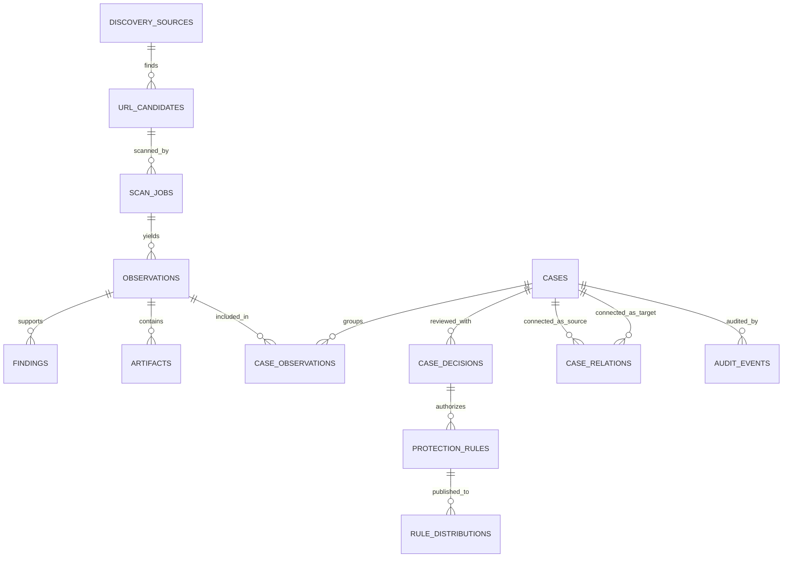

# Database and evidence storage design

**Database:** PostgreSQL (proposed), SQLAlchemy + Alembic. Primary keys use UUIDs in production; examples use short IDs for readability. All tables have `created_at` and `updated_at` in UTC where relevant.

## 1. Entity relationship diagram

## 2. Core tables

### `discovery_sources`

`id uuid PK`, `type enum(manual,serp,places,feed,community,fixture)`, `provider`, `query_text nullable`, `locale nullable`, `provider_ref nullable`, `capture_mode enum(live,fixture)`, `observed_at timestamptz`, `license_metadata jsonb`.

**Important:** For Google Places, store approved **Place IDs** rather than an indiscriminate permanent local copy of Maps business data. Refresh restricted fields when needed and follow provider terms.

### `url_candidates`

`id uuid PK`, `source_id FK`, `original_url text encrypted_or_restricted`, `canonical_url text`, `url_sha256 char(64)`, `hostname text`, `display_hostname text`, `first_seen_at`, `last_seen_at`, `source_context jsonb`, `admission_status`, `admission_reason`.

Unique index on `(url_sha256, source_id)`; dedupe logic may link the same URL from multiple sources.

### `scan_jobs`

`id uuid PK`, `candidate_id FK`, `requested_by nullable`, `profile`, `status enum(queued,running,completed,partial,blocked_by_policy,failed)`, `attempt_count`, `started_at`, `completed_at`, `error_code nullable`, `analyzer_version`, `model_version nullable`, `fixture boolean`, `idempotency_key`.

### `observations`

`id uuid PK`, `job_id FK`, `requested_url`, `final_url nullable`, `http_status nullable`, `redirects jsonb`, `browser_profile`, `page_title nullable`, `page_text_excerpt nullable`, `hostname_ips jsonb restricted`, `form_metadata jsonb`, `screenshot_artifact_id nullable`, `captured_at`, `collection_notes`.

Do not store form values or cookies captured from real users.

### `findings`

`id uuid PK`, `observation_id FK`, `kind enum(reputation,domain,visual,text,redirect,form,cloaking,related_infra)`, `label`, `severity`, `confidence_note`, `raw_signal jsonb`, `score_contribution smallint`, `evidence_ref nullable`, `detector_version`, `human_verified boolean default false`.

### `cases`

`id uuid PK`, `title`, `status enum(unreviewed,in_review,needs_more_evidence,confirmed_malicious,dismissed)`, `risk_score smallint nullable`, `risk_band`, `source_summary`, `assigned_to nullable`, `first_seen_at`, `last_seen_at`, `reviewed_at nullable`.

### `case_observations`

`case_id FK`, `observation_id FK`, `relevance_note`, composite PK.

### `case_decisions`

`id`, `case_id FK`, `actor_id`, `action enum(confirm,dismiss,reopen,escalate)`, `reason`, `evidence_snapshot_hash`, `created_at`; **append-only**.

### `case_relations`

`id`, `source_case_id FK`, `target_case_id FK`, `relation_type`, `confidence_category`, `supporting_finding_ids uuid[]`, `observed_at`. One edge is a **hypothesis**, not proof of common operator.

### `artifacts`

`id`, `observation_id FK`, `artifact_type enum(screenshot,har,html_excerpt,report,other)`, `private_storage_key`, `sha256`, `bytes`, `mime_type`, `captured_at`, `collector_version`, `redacted boolean`, `retention_until`, `provenance_notes`.

### `protection_rules`

`id`, `indicator` (normalized URL/domain), `match_type`, `action enum(block,allow,remove)`, `status enum(draft,approved,revoked,expired)`, `source_case_id`, `approved_decision_id`, `valid_from`, `expires_at`, `created_by`, `approved_by`, `rule_version`.

### `rule_distributions`

`id`, `ruleset_version`, `published_at`, `checksum`, `minimum_extension_version`, `rollback_of nullable`, `signing_key_id nullable`.

### `audit_events`

`id`, `actor_type`, `actor_id nullable`, `target_type`, `target_id`, `action`, `before_hash`, `after_hash`, `occurred_at`, `request_id`, `remote_ip_hmac nullable`.

## 3. Recommended indexes and migrations

- B-tree on `scan_jobs(status,created_at)`, `cases(status,risk_score,last_seen_at)`, `observations(captured_at)`.
- Unique on `url_candidates(url_sha256,source_id)` and `scan_jobs(idempotency_key)`.
- Partial index for approved active protection rules (`status='approved'`).
- GIN on selected `jsonb` only after real query needs arise, not by default.
- Migration v001 tables, v002 indexes, v003 rules/audit, with explicit downgrade strategy and backup.

## 4. Storage decisions

- Store screenshots/PDF/large HTML in a **private artifact volume**, not giant Postgres `bytea` columns.
- Store SHA-256 digest in DB; hash does not prove truth of the origin, only byte integrity from capture onwards.
- Presigned URL or authenticated streaming endpoint for downloads; short expiry.
- Backup DB and artifacts together to preserve references; run periodic orphaned-artifact cleanup.

## 5. PII, access and deletion

- Treat submitted URLs as potentially sensitive: path/query tokens can contain secrets. Redact logs and restrict access.
- Strip tokens/cookies/identifiers from screenshots and external AI payloads where feasible; ask user before uploading evidence.
- Pilot retention proposal (to approve): raw scans 7 days, redacted artifacts 30 days, audit 90 days, case material with legal hold by policy. **These are suggested defaults, not UAE legal requirements.**
- Implement `delete_request` and retention jobs in product roadmap; no blanket indefinite storage.
- Enforce roles: `viewer`, `analyst`, `admin`; only analysts/admins can confirm, only admins can publish rules unless two-person process implemented.

## 6. Data quality and provenance

For each candidate/observation retain `capture_mode`, time in UTC, provider name, fetch status, analyzer version, and evidence ID. Never mix fixture data into live metrics without a visible filter.

**Important:** This schema is a proposal. Generate actual migrations and review constraints against real provider contracts during implementation.
