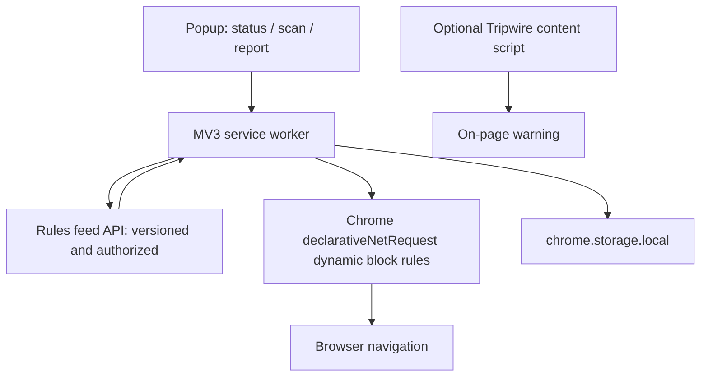

# ScamShield Guardian - Chrome extension design

## Objective

Give ordinary web users understandable protection **without** gathering passwords, private chats, or all browsing history. The MVP covers **approved known malicious destinations**, with explicit user-triggered URL scans and a clear extension status. AI analysis of an unknown URL is asynchronous, so do not promise instantaneous pre-request blocking of all unknown websites.

## 1. Core components

### `background`

- On install/start, check local approved rules and version.
- On user action / periodic alarm, fetch versioned feed, validate schema, origin and integrity, apply delta with `updateDynamicRules`.
- Store last successful ruleset version and expiration in `chrome.storage.local`; avoid persistent globals (service worker sleeps).
- If feed expires or signature is invalid: show degraded status, do not add new rules blindly; use configured expiry/removal policy.

### `popup`

- Protection state: active/syncing/offline.
- Manual scan of active-tab URL via backend with consent.
- Last confirmed block count from local rule events if available (do not invent large global metrics).
- Manage opt-in protection, open evidence/info page, contact/help.

### `content script` (P2)

- Optional permission for sites on which user asks for a Tripwire check.
- Detect existence of password/OTP/payment input types and suspicious `form.action` destination; **do not read/record entered values**.
- If hostname is known flagged, show a high-contrast warning **before form submit** with safe close/override flow.
- Avoid changing fields or injecting remote code. Add keyboard and screen-reader support.

## 2. Block rule mechanics

Chrome's `declarativeNetRequest` can block matching network requests **before** they are sent for already installed rules. Use dynamic rules with limited exact-domain match or safer defined patterns. Restrict to main-frame requests for demo where possible; avoid accidentally blocking harmless third-party subresources.

**Policy:** Only `confirmed_malicious` + approved + unexpired indicator -> DNR `block`. `high_risk` (unconfirmed) -> warning/report, no mandatory block.

**Demo:** Prepare two Chrome profiles. In Profile A, admin confirms a controlled test domain and publishes rule. In Profile B, Guardian syncs and Chrome blocks navigation. Then revoke the rule and verify successful subsequent navigation to benign controlled content.

## 3. Unknown-site limitations

| Scenario | Guarantee |
|---|---|
| Previously confirmed domain with installed rule | Can block before network request via DNR |
| Unseen domain requiring server analysis | **Cannot guarantee** pre-request verdict; async scan and warn when ready |
| Browser without extension/permissions | No extension protection |
| Site inside non-browser mobile app | Not covered by Chrome extension |
| Device off/offline | Only last valid locally installed rules apply |
| Host differs by redirect | Only known matched patterns blocked; unknown hops investigated later |

This distinction is a key technical credibility point for judges.

## 4. Privacy and permissions

- Prefer `activeTab` for user-initiated scans, `storage`, `alarms`, `declarativeNetRequest` plus narrow optional host permissions when needed.
- No `<all_urls>` or browser history permission by default. If broad permissions are essential, explain exactly why and offer opt-in.
- Never log URLs that contain tokens without scrubbing; don't upload private URLs automatically.
- Never inspect values of credentials, bank fields or OTP inputs.
- Show ruleset publisher and sync timestamp; let user disable protection (with clear consequences).

## 5. Threat and product risks

- **False positives:** Block only human-approved indicators; have rollback, expiry and a feedback path.
- **Rules abuse:** Authenticate or cryptographically sign feed; do not let any single untrusted model publish blocks.
- **Rule count/regex limitations:** Verify Chrome version and DNR limits before broad feeds. Start with <100 controlled rules.
- **Worker lifecycle:** An MV3 service worker is event-driven and may terminate. Persist state in `chrome.storage.local` and use alarms.
- **Install friction:** For hackathon, load unpacked extension. Explain this is developer installation, not public store distribution.

## 6. Guardian completion checklist

- [ ] Installed unpacked in Chrome as MV3
- [ ] Receives only approved rules from API
- [ ] Known controlled malicious test URL blocked
- [ ] Known legitimate control remains accessible
- [ ] Rule rollback restores access
- [ ] Offline/error state accurately communicated
- [ ] No credential values read or recorded
- [ ] Keyboard-accessible warning with screen-reader text

**References:** https://wxt.dev/ , https://developer.chrome.com/docs/extensions/reference/api/declarativeNetRequest , https://developer.chrome.com/docs/extensions/develop/concepts/service-workers/lifecycle , https://developer.chrome.com/docs/extensions/develop/concepts/declare-permissions
