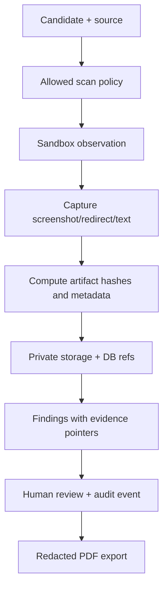

# Evidence collection, case reporting and investigator audit

## 1. Purpose and caveat

ScamShield should create **reviewable technical records**, not merely a red "SCAM" label. These records can support investigator triage and reporting. They are **not automatically forensic-grade or legally admissible**, and no official police case-management integration is claimed.

## 2. Minimum evidence record per observation

| Field | Why it matters |
|---|---|
| Case ID / scan ID / observation ID | Traceability and reproducibility |
| Source type and query / Places ID | Explains where the URL was discovered |
| Original and canonical URL (safely redacted if sensitive) | Exact target context |
| Requested / final URL and redirect hop list | Shows navigation journey |
| UTC capture time with clock source | Ordering and case chronology |
| Screenshot or screenshot failure reason | Visual account of observed page |
| Page title/text excerpt and form field metadata | Explainable identity/content signals |
| Collector, browser profile, analyzer/model versions | Reproduction and provenance |
| SHA-256 for stored artifacts | Detects later modification of captured bytes |
| Findings and their supporting evidence IDs | Prevents unsupported narrative |
| Risk score/threshold **at the time** | Review context, distinct from analyst decision |
| Analyst decision + timestamp + reason | Accountability |
| Limitations and provider failures | Prevents overclaiming completeness |
| Live vs fixture marker | Honest demonstration and metrics |

## 3. Collection workflow

- All timestamps should be recorded in UTC internally; UI may show UAE local time clearly marked.
- Record missing content as `unavailable`, not blank or guessed.
- Do not overwrite raw captured files under the same artifact ID. New observation -> new artifact/version.
- A SHA-256 digest shows artifact integrity **since hashing**; it does not validate website identity or legal chain of custody by itself.

## 4. Report template structure (PDF)

1. **Cover:** ScamShield AI - automated triage report, case ID, generation timestamp, "Prototype / Not official police finding" label.
2. **Executive summary:** Provisional risk band, human review status, source and one-paragraph reason.
3. **Discovery record:** Original query/source, provider, capture mode, first observed time.
4. **Domain and navigation record:** Normalized host, RDAP/DNS data if available, full redirect timeline with permitted/sanitized URLs.
5. **Technical findings:** Severity, evidence source, actual screenshots, excerpts, supporting limitations.
6. **Visual comparison:** Reference identity, comparison method, screenshot annotation, avoid claiming trademark violation as fact.
7. **Relations:** Shared fingerprints with other cases and why this is only a hypothesis.
8. **Analyst actions:** Decisions, actor/role, timestamp and rationale; if none say "Not reviewed."
9. **Appendix:** Artifact IDs, hashes, versions, job details, source terms/disclaimer.
10. **Privacy note:** What has been redacted and which sensitive details were excluded.

## 5. Report statuses

Use one of these exact prominent headings:

- `Automated triage only - not human reviewed`
- `Under investigator review`
- `Analyst confirmed suspicious/malicious under internal review policy`
- `Dismissed / not supported by available evidence`
- `Inconclusive - inspection unavailable or incomplete`

Avoid "officially convicted," "police certified" or "100% verified scam." Do not include a government crest/branding without authorization.

## 6. Retention, privacy and disclosure

- Protect source URLs because URL paths/queries may contain personal tokens.
- Redact personal details in public-facing reports. Maintain originals in restricted storage only where permission and necessity are documented.
- For screenshots, redact actual pixels in a derived copy; don't place opaque overlay that can be removed to reveal source.
- Make sharing/export auditable; log who downloaded reports and when.
- Follow provider terms for exported data, including Google Maps content restrictions and URL intelligence vendor licenses.
- Retention/default disposal in [Data Model](07-DATA-MODEL.md) is only a **draft policy**, not asserted legal compliance.

## 7. Human review workflow

1. Analyst verifies candidate and source authenticity.
2. Checks indicator evidence and alternative benign explanations.
3. Can request additional observation or compare with curated official source.
4. Marks confirm, dismiss, or more evidence with written reason.
5. Admin separately approves a protection rule (with TTL) if appropriate.
6. If later overturned, case decision history remains append-only and rule is revoked.

## 8. Quality gates for export

- [ ] No wrong case or source IDs
- [ ] Real captured timestamps, not generated UI placeholders
- [ ] Each severity claim has evidence pointer
- [ ] Visuals are actual captured artifacts or prominently marked fixture
- [ ] Redacted sensitive data is unreadable/unrecoverable from exported PDF
- [ ] Missing providers/models acknowledged
- [ ] Reviewer status and uncertainty displayed
- [ ] Document opens on another machine and text does not clip
- [ ] Filename contains safe case ID, date, not a user's private data
