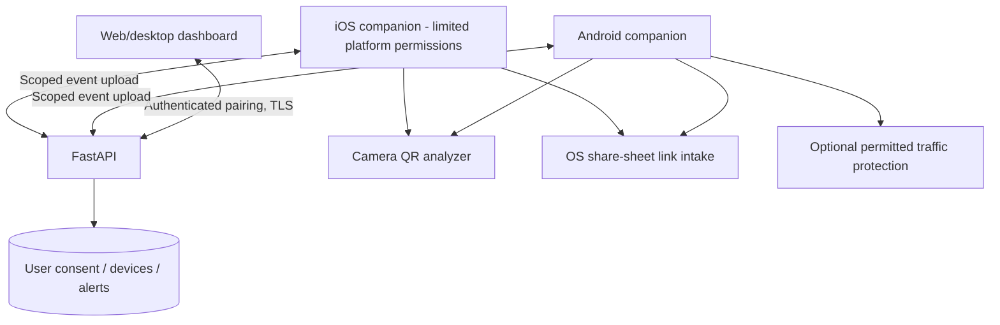

# Phone Connect, ScamShield AR and on-device experiences (post-MVP)

## 1. Product ambition versus OS reality

A web dashboard cannot quietly scan an entire connected Android or iOS device. The browser cannot enumerate arbitrary installed apps, read other apps' messages or history, or intercept all network traffic. **Phone Connect requires an explicitly installed native companion and platform-specific, revocable permissions.** The scope of access must be explained and visible.

Two realistic tracks:

1. **Camera QR safety:** Can be demonstrated as a mobile web/PWA experience using browser camera permission and a QR decoding library (where supported) without full native phone scanning.
2. **Device/network security companion:** Requires native Android/iOS capabilities, consent and significant platform review. This belongs after the hackathon unless a simple separately scoped companion is already built and permitted.

## 2. Future architecture

Pairing design: desktop creates one-time short-lived QR; native app scans and displays exact scopes; server exchanges code for device-bound session; user can list/revoke devices, rotate credentials and delete data. Do not rely on QR alone as permanent authentication. Use HTTPS, PKCE/device binding if implementing OAuth, and nonce/expiry/replay protection.

## 3. Phone companion permissions

| Capability | Android approach | iOS approach | Constraints |
|---|---|---|---|
| Scan a printed QR | Camera permission, on-device QR library | Camera permission, on-device QR library | No auto-open |
| Analyze a link from WhatsApp/SMS | User shares text to companion via OS share | Share extension with user action | **Not** silent reading of chats |
| Check a web URL | Opt-in browser / share flow | Opt-in browser / share flow | Provider calls and privacy |
| Broad network-domain protection | OS VPN service with explicit permission, careful design | Network Extension entitlements / constraints | Significant work and user trust costs |
| Examine installed applications | OS-limited package visibility, policy constraints | Generally heavily constrained | Not full malware scanning by web app |
| Capture visible screen | Explicit OS screen-capture prompt | Explicit screen capture/broadcast entitlement | Sensitive; X-Ray undecided |
| Desktop pairing | QR + authenticated account/device binding | QR + authenticated account/device binding | Revocable, expires |

For hackathon, only a **phone camera QR demo** may be plausible as optional P2. A native "scan my whole phone" claim is not credible on a 24-hour timeline.

## 4. ScamShield AR design (selected)

**Scenario:** QR code on parking sign claims to open a government payment portal.

1. Camera view receives permission.
2. QR decoding happens locally; extract URL and show the actual hostname before navigation.
3. Call reputation+URL scanner; show clear status: `known-dangerous`, `suspicious`, `no-known-indicators`, `unavailable`.
4. Overlay concise caution visually on a frozen-frame card / viewfinder (avoid fake 3D spatial tracking if not built).
5. If user chooses "official site," destination comes from an **independently verified source registry**; never guess URL from a brand name.
6. User can copy or submit QR destination; do not open it automatically.

**Accessible alternatives:** Upload a QR image, paste a URL, enlarge text, high contrast, avoid color-only risk coding, support camera-denied mode.

**Demo test:** Controlled benign QR and controlled suspicious QR on printed sheets. Both lead to `.test`/fixture destinations; scanner warns only where evidence exists. Never present a real police/parking payment page as team-operated.

## 5. Credential Tripwire and Guardian on mobile

Mobile browsers and webviews vary in extension support; do not claim a Chrome desktop MV3 extension protects WhatsApp's internal webview or every Android/iOS app. On native companion, share sheet or optional network protection gives scoped signals, not full webpage field inspection unless platform integration supports it.

## 6. Data minimization

- Record only necessary analyzed URL/host, verdict, timestamp, user-approved evidence IDs.
- Do not upload contact list, full installed-app list, microphone recordings or browser history by default.
- User opts into optional services separately and can see exact collected fields.
- Device screen analysis must not run persistently or secretly.
- User may disconnect a paired phone with immediate server token revocation.

## 7. Go/no-go for a hackathon AR prototype

- P0 is complete.
- Browser/mobile camera permission and QR decoding work on the actual demo phone.
- URL classification API handles decoded links quickly or displays pending state.
- Offline/error UI is clear; printed controlled QR cards are prepared.
- Privacy notice and no-auto-open behavior tested.
- AR does not displace Guardian/Discovery core challenge proof.

## 8. Roadmap milestones

- **M1:** Mobile-responsive web scanner and QR intake.
- **M2:** Android share sheet companion and user-managed account pairing.
- **M3:** Consent-based scoped network/URL protection, subject to platform policy and testing.
- **M4:** iOS feasible features review and secure native distributions.
- **M5:** Optional X-Ray only after privacy/security design and explicit user selection.
